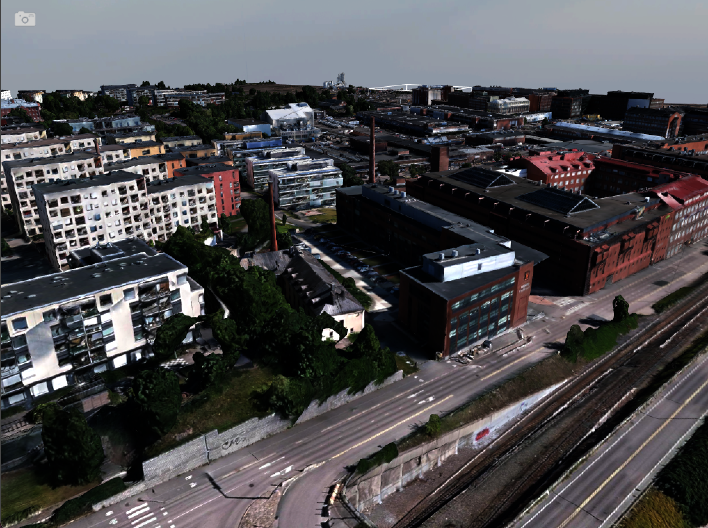
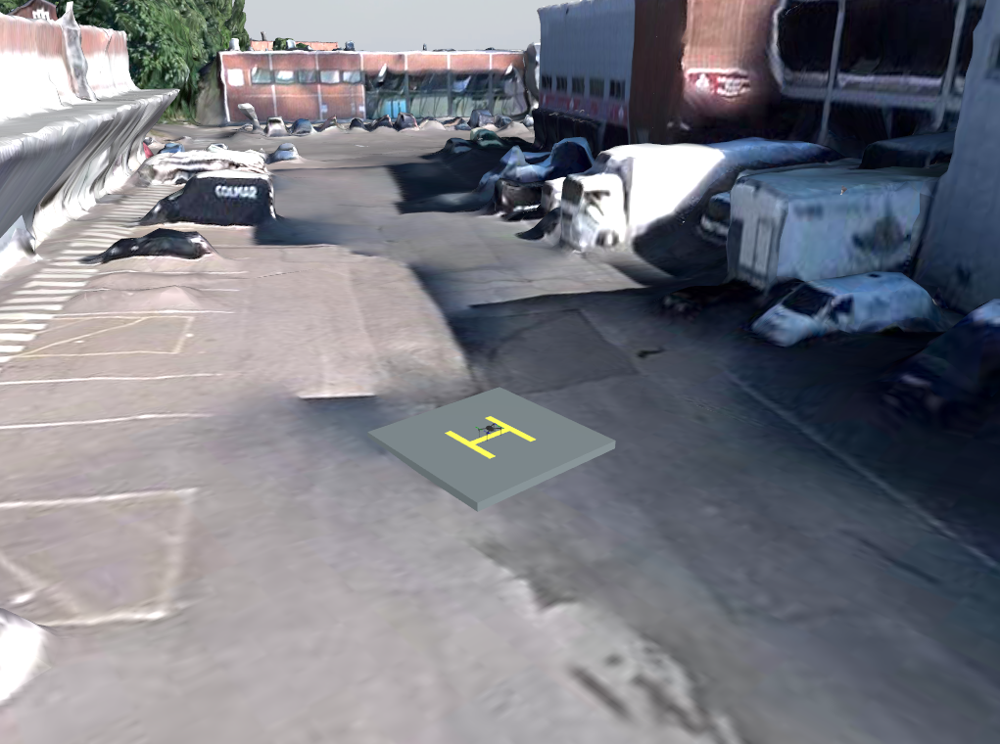
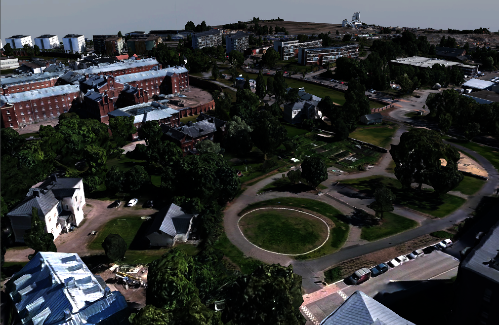

# Bitirme Projem — Gazebo'da Drone Uçuşu

Bitirme projemde GPS/GNSS olmadığında veya uçuş sırasında kesildiğinde, drone'un kamera, IMU ve önceden bilinen haritayı kullanarak başlangıç noktasına dönebilmesini hedefliyorum. Bunun için önce Gazebo'da uçurabildiğim ve ölçüm alabildiğim bir simülasyon ortamı hazırladım.

Şehir modeli için Helsinki Belediyesi'nin Helsinki 3D Mesh 2017 verisini kullandım. Ortama Iris quadcopter ekledim ve ArduPilot SITL ile kalkış, kısa hareketler, başlangıca dönüş ve inişi çalıştırdım.

**Şu an uçuşta GPS açık. Henüz GPS'siz dönüşü tamamlamadım.** Bu sürümde doğruladığım kısım, simülasyonda uçuş ve ilk Home noktasına geri dönüş.



## Neler yaptım?

- 1 × 1 km'lik bir alanı seçip harita parçalarını aynı koordinat sisteminde birleştirdim.
- Merkezde daha ayrıntılı model kullandım; küçük birleşim hatalarını ve yüzey normallerini düzenledim.
- Ortamın ışıklarını ayarlayıp dünya dosyasına kaydettim.
- Iris modelinin gövde, rotor ve fizik özelliklerini koruyarak ArduPilot SITL bağlantısını kurdum.
- Drone'a aşağı bakan 640 × 480 kamera ve ayrı bir 200 Hz IMU ekledim, veri akışlarını kontrol ettim.
- Kalkış için H işaretli 4 × 4 metrelik bir alan hazırladım.
- Kalkış, hedefe gitme, bulunduğu yerde iniş ve Home'a dönüş komutlarını tek terminalden kullanabildiğim bir başlatıcı yazdım.
- Başka bir yerde inip tekrar kalkınca Home'un değişmesi sorununu düzelttim. İlk H noktası oturum boyunca sabit kalıyor.
- Uçuş süresi dolduğunda önce Home'a dönüp, konum ve yatay hız kararlı olduğunda inmesini sağladım.
- Home davranışını iki kalkışlı otomatik senaryoyla, kodu da birim testlerle kontrol ettim.

Bu repoda şehir dünya dosyası, drone ekleyen ve uçuşu başlatan kodlar, yüzey işleme kodları, testler ve çalışma planım bulunuyor. Büyük şehir modeli ve doku dosyalarını [indirilebilir pakette](https://github.com/rabiasn/gnss-denied-drone-navigation/releases/tag/gazebo-helsinki-v6) paylaştım. ArduPilot kaynaklarını ve derlenmiş dosyaları repoya koymadım; kullandığım sürümleri ve kurulumu [uçuş kılavuzuna](docs/drone-ucus-kilavuzu.md) yazdım.

## Home noktası



Bu görüntüyü Gazebo'daki gerçek simülasyonumdan aldım. H işareti, kalkış ve geri dönüş için kullandığım başlangıç alanını gösteriyor. Drone'un boyutunu görüntü için büyütmedim.

İlk uçuşları başlangıcın 10 metre çevresinde ve yaklaşık 18 metre yükseklikte sınırlandırdım. Bu sınırları otomatik engelden kaçınma olarak değerlendirmiyorum.



## Ortamı açma

Ortamı MacBook'ta Gazebo Harmonic ile çalıştırdım. Açmak için Gazebo'nun (`gz` komutu) ve Python 3.10 veya üzerinin kurulu olması gerekiyor.

```bash
git clone https://github.com/rabiasn/gnss-denied-drone-navigation.git
cd gnss-denied-drone-navigation
python3 scripts/download_gazebo_assets.py
python3 scripts/open_gazebo_world.py --view district
```

İndirme komutu modelleri ve dokuları indiriyor, açılış komutu ortamı açıyor. Harita büyük olduğu için ilk yükleme biraz sürebiliyor. Kapatmak için terminalde `Ctrl+C` kullanıyorum. Genel görünüm için `--view district` yerine `--view overview` yazılabilir.

Işık ayarlarım `gazebo/helsinki/world.sdf` dosyasında kayıtlı. Arayüzde yaptığım yeni ayarları saklamak için **Save world as** seçeneğini kullanıyorum.

## Drone'u uçurma

[Uçuş kılavuzundaki](docs/drone-ucus-kilavuzu.md) ArduPilot ve Gazebo eklentisi kurulumu tamamlandıktan sonra:

```bash
python3 scripts/fly_drone.py
```

`Hazır` mesajından sonra aynı terminalde, her hareketin ardından `hover` yazısını bekleyerek şu komutları kullanıyorum:

```text
kalkis
git 5 0
git 5 4
don
```

`git` değerlerini ilk Home'a göre kuzey ve doğu metreleri olarak veriyorum; bunlar art arda eklenen hareketler değil. `don` ilk H'ye dönüp iniş yapıyor, `in` bulunduğu yerde iniş istiyor. `landed` mesajından sonra `cik` yazarak oturumu kapatıyorum. Varsayılan 180 saniyelik uçuş süresi dolunca da önce Home'a dönüş başlıyor.

## Neleri test ettim?

- GPS açıkken kalkış, kısa parkur, Home'a dönüş ve motorlar kapalı iniş.
- H'den uzakta iniş, aynı oturumda yeniden kalkış ve ilk H referansının korunması.
- Süre dolunca bulunduğu yerde kalmak yerine Home'a dönüş ve iniş.
- Yerel model yolları, hedef sınırları ve Home davranışı dahil 55 birim test. Iris model testi için dış bağımlılığın kurulmuş olması gerekiyor.

[Home kontrol sonucunu](docs/test-results/home-return-2026-10-20.json) ayrıca paylaştım. Bunlar ideal simülasyon sonuçları; gerçek uçuş doğruluğu veya GPS'siz çalışma kanıtı olarak sunmuyorum. Simülatörün gerçek konumunu yalnız değerlendirme için ayırdım.

## Sırada ne yapacağım?

1. Şu an kalkışta aldığım 8 saniyelik kamera–IMU kaydını tüm uçuşu kapsayacak şekilde genişleteceğim.
2. Aynı kısa parkuru tekrar uçurup kamera + IMU ile hareket tahminini, yani VIO'yu, kararlı hâle getireceğim.
3. Konum tahminini ArduPilot'a önce pasif olarak aktaracak; zaman, eksen ve belirsizlik bilgilerini kontrol edeceğim.
4. Küçük alanda GPS'ten görsel konumlamaya geçişi ve kısa GPS'siz uçuşu test edeceğim.
5. Helsinki haritasıyla görüntü eşleştirerek biriken konum hatasını azaltacağım; yanlış eşleşmeleri ayrıca deneyeceğim.
6. Uçuş sırasında GPS kesilmesini, kaynak geçişini, Home'a dönüşü ve inişi birleştireceğim.
7. Başlangıçtan GNSS'siz çalışma, sensör kayıpları ve tekrarlı karşılaştırmalı deneyleri tamamlayacağım.

Bir adımın testi geçmeden sonrakine geçmeyeceğim. [Görev sıramı, süre tahminlerimi ve başarı ölçütlerimi](docs/yol-haritasi.md) ayrı yazdım. Otomatik engelden kaçınma, gerçek donanım uçuşu ve satışa hazır ürün bu sürümde tamamlanmış değil.

[Güncelleme notlarım](docs/guncellemeler.md).

## Veri kaynağı ve lisans

Kullandığım model ve dokular Helsinki Belediyesi'ne ait ve **CC BY 4.0** lisanslı. Model üzerinde koordinat dönüşümü, yüzey ve parça birleşimi düzenlemeleri yaptım. Fotoğraflar, Gazebo'da açtığım ortamdan aldığım ekran görüntüleri.

- [Helsinki Belediyesi — Helsinki 3D](https://www.hel.fi/en/decision-making/information-on-helsinki/maps-and-geospatial-data/helsinki-3d)
- [CC BY 4.0 lisansı](https://creativecommons.org/licenses/by/4.0/)
- [Kaynak ve değişiklik bilgileri](gazebo/helsinki/ATTRIBUTION.txt)
- Iris modeli ve Gazebo eklentisi: [ArduPilot/ardupilot_gazebo](https://github.com/ArduPilot/ardupilot_gazebo), LGPL-3.0.
- Uçuş yazılımı: [ArduPilot](https://github.com/ArduPilot/ardupilot), GPL-3.0. Bağımlılıkların kendi lisansları geçerli; bunları kendi yazdığım bileşenler olarak sunmuyorum.
